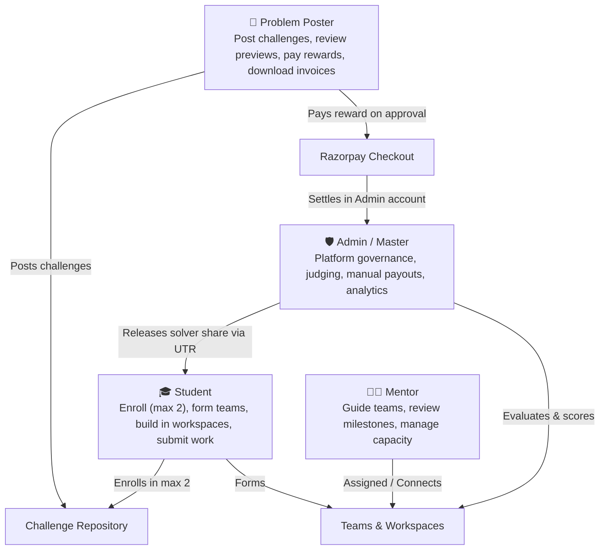

**Solmira — Complete Project & Features Guide**  
***Tagline:*** *"Structured Thinking for Real India"*  
 
***Mission:*** *An innovation ecosystem where real Indian civic, industrial, and social challenges meet structured, milestone-driven student solutions, evaluated through blind judging, backed by dedicated mentors, team workspaces, and guaranteed reward payouts.*  

---  
### 1. Project Overview & Architecture  
**Solmira** is an end-to-end platform bridging college students, problem posters (civic bodies, NGOs, faculty, industries), and expert mentors into structured, collaborative workspaces with integrated evaluation and reward settlement.  

#### Tech Stack  
| Layer | Technology | Description |  
| :--- | :--- | :--- |  
| **Runtime** | Node.js 20+ | High-performance asynchronous backend runtime |  
| **Server Framework** | Express 4 | Modular REST API with 14 domain routers and 44 clean-URL page routes |  
| **Frontend** | Vanilla HTML5 / Modern CSS / ES6+ JS | 44 clean pages, zero build step, zero bundler, no React overhead |  
| **Database & Auth** | Supabase (PostgreSQL 15+) | Row Level Security (RLS), Supabase Auth with JWT Bearer tokens |  
| **File Storage** | Supabase Storage (`multer` in memory) | Buckets for thumbnails, submission deliverables, and blog images |  
| **Payment Gateway** | Razorpay SDK (`razorpay: ^2.9.8`) | UPI, Cards, Netbanking checkout, webhook verification, and invoice generation |  
| **AI Evaluation Engine**| Groq API (`llama-3.3-70b-versatile`) | Automated 8-criteria technical & complexity evaluation with heuristic fallback |  
| **Mailing / OTP** | Nodemailer (SMTP) | Collegiate domain-gated email verification and one-time password delivery |  

#### Project Directory Structure  
```text  
Solmira/  
├── client/                     # 44 Vanilla HTML pages, design system, and client runtime  
│   ├── assets/app.js           # Supabase client, auth guards, API client, lazy-load observer  
│   ├── assets/styles.css       # Unified design system (.card, .btn, .sk skeleton shimmers)  
│   ├── assets/payments.js      # Razorpay client checkout modal trigger  
│   ├── assets/invoice.js       # Client-side printable/downloadable GST tax invoice  
│   ├── assets/domain-themes.js # Category gradient covers for problems without thumbnails  
│   ├── assets/thumb-crop.js    # Interactive thumbnail cropping utility  
│   └── *.html                  # Clean-URL mapped user interfaces (/problems, /checkout, etc.)  
├── server/  
│   ├── server.js               # Entry point: gzip, static caching, 44 clean page routes, 14 routers  
│   ├── supabase.js             # Dual client initialization (service-role admin + anon user client)  
│   ├── middleware/             # Auth verification (JWT), file upload (multer), 60s GET caching  
│   ├── lib/                    # Core logic: Razorpay, payment math, solution preview, AI evaluator  
│   │   ├── razorpay.js         # Razorpay client & webhook HMAC signature verification  
│   │   ├── payment-math.js     # Platform fee splits (10% platform, 90% solver share)  
│   │   ├── solution-preview.js # Dynamic gating probe for solution preview teaser  
│   │   ├── deliverables.js     # Stage-2 final artifact validator (max 5 items)  
│   │   ├── ai-evaluator.js     # Groq llama-3.3-70b evaluation engine  
│   │   └── leaderboard-sync.js # Live score calculation and department aggregation  
│   └── routes/                 # 14 REST API routers (problems, teams, workspaces, payments, etc.)  
├── payments/                   # Payment integration guides, test mode instructions, source maps  
├── supabase/migrations/        # SQL migration files defining tables, RLS policies, and triggers  
└── scripts/                    # Database seeding and migration execution utilities  
```  

---  
### 2. User Roles & Permissions  
The platform enforces strict role-based access control (RBAC) across 4 primary personas:  



1. **Student (`student`):**  
   - Discovers civic, industrial, and campus challenges.  
   - Enrolls in challenges (restricted to **maximum 2 concurrent active enrollments**).  
   - Forms or joins teams using unique invite codes (`SOLMIRA-XXXXXX`).  
   - Collaborates in private workspaces with dedicated channels, file sharing, and milestones.  
   - Two-stage submission: Stage 1 written solution with public teaser preview, and Stage 2 final upload for up to 5 deliverables.  
   - Connects with mentors for technical guidance.  
2. **Problem Poster (`poster`):**  
   - Posts structured real-world problem statements (scope, constraints, deliverables, awards).  
   - Inspects enrolled student solutions through a gated teaser preview.  
   - Approves submissions and pays the reward via integrated Razorpay Checkout (`/checkout/:submissionId`).  
   - Full 7-field solution content unlocks automatically upon payment.  
   - Downloads professional GST-compliant invoices for paid rewards.  
3. **Mentor (`mentor`):**  
   - Maintains a rich mentor profile (skills, tech stack, bio, portfolio, availability).  
   - Manages capacity via `max_active_teams` to avoid over-commitment.  
   - Accepts or declines mentorship requests from teams or individual students.  
   - Gains mentor access to workspace channels and milestone progress tracking.  
4. **Admin / Master (`admin`, `is_master`):**  
   - Full cross-user administration via the Supabase service-role client.  
   - Approves, rejects, and moderates problem statements and blog articles.  
   - Oversees blind judging and milestone score aggregation.  
   - Administers manual solver payouts on `/admin/payouts` and logs banking UTR confirmation numbers.  
   - Platform-wide analytics (enrollments, completion rates, active students).  

---  
### 3. Core Features & Capabilities  

#### 3.1 Problem Lifecycle & AI-Powered Difficulty Scoring  
- **Structured Challenge Creation:** Problem posters define title, category, type, context, statement, scope, constraints, deliverables, milestones, and reward amounts.  
- **Domain-Themed Problem Covers (`domain-themes.js`):** When posters do not upload a custom image, Solmira automatically generates a domain-specific gradient cover (AI & Data, Climate, Healthcare, Public Impact, Developer Tools).  
- **AI-Powered Complexity Evaluation (`server/lib/ai-evaluator.js`):**  
  - Problems are analyzed across **8 weighted criteria** using Groq's `llama-3.3-70b-versatile`:  
    - *Technical Complexity (25%)*, *Implementation Complexity (20%)*, *Engineering Effort (15%)*, *Research Complexity (10%)*, *Testing Complexity (10%)*, *Domain Knowledge (10%)*, *Collaboration Need (5%)*, *Innovation (5%)*.  
  - Maps score to: **Beginner (1.0x)**, **Intermediate (1.5x)**, **Advanced (2.2x)**, or **Expert (3.0x)** leaderboard weights.  
  - Generates recommended team sizes, estimated hours/weeks, required skills, and risk profiles.  
  - Algorithmic fallback (`server/lib/problem-evaluator.js`) ensures evaluation continues even if external AI APIs are offline.  

#### 3.2 Two-Stage Submission Flow & Solution Preview Gating  
- **Stage 1 — Written Solution Framework (`submit.html`):**  
  - 7 structured fields: *Problem Understanding, Proposed Architecture, Technical Feasibility, Resource Plan, Testing Strategy, Risk Mitigation, Deliverables Summary*.  
  - Supports rich text or direct PDF attachments per field.  
  - **Solution Preview Teaser (`f_preview`):** A mandatory 40+ word summary visible to everyone before reward payment.  
- **Solution Preview Gating (`solution-preview.js`):**  
  - The problem poster only sees the teaser preview while reviewing submissions.  
  - The full 7-field solution is encrypted/hidden on read until payment is verified.  
- **Stage 2 — Final Deliverables (`final-upload.html`):**  
  - Unlocked once Stage 1 is reviewed and approved.  
  - Students attach up to 5 final assets (live URLs, GitHub repos, APK builds, research papers, demo videos up to 25 MB each).  

#### 3.3 Razorpay Payment Gateway, Escrow/Split & Manual Payouts  
- **Secure Poster Checkout (`/checkout/:submissionId`):**  
  - Initiates payment directly from `/poster/solutions` using Razorpay Checkout (UPI, Netbanking, Cards).  
  - Order generation and client checkout modal trigger (`client/assets/payments.js`).  
- **10% Platform Fee Split (`server/lib/payment-math.js`):**  
  - Example: For a ₹10,000 reward, ₹1,000 is retained as platform fee, and ₹9,000 is credited to the solver's payout queue.  
- **Webhook Handlers (`server/routes/payments.js`):**  
  - Verifies Razorpay HMAC-SHA256 signatures for `payment.captured`, `order.paid`, and `payment.failed`.  
- **Safe Manual Admin Payouts (`/admin/payouts`):**  
  - No money is ever sent to students automatically. Funds settle into the platform's administrative account.  
  - The admin inspects verified solver bank/UPI details, transfers the net share, and records the bank reference (UTR) to mark the payout completed.  
- **GST / Tax Invoicing (`client/assets/invoice.js`):**  
  - Instantly renders and prints a formatted tax invoice with breakdown of gross reward, platform fee, and invoice metadata.  

#### 3.4 Teams & Private Workspaces (The Collaboration Hub)  
Each team gets an isolated, Discord/Slack-style collaboration hub:  
- **Team Formation:** Instant creation with a generated invite code (format: `SOLMIRA-XXXXXX`).  
- **Channels:** Dynamic public and private text channels (with a persistent `#general` channel).  
- **Interactive Milestones:** Team members create, assign, and mark milestones as done, updating the workspace progress ratio dynamically.  
- **Categorized File Management:** Central team repository for documentation, architecture diagrams, datasets, and presentation decks.  
- **Workspace Announcements:** Pinned notices with expiration dates and categorization (`general`, `poster`, `system`, `deadline`).  
- **Activity Audit Trail:** Real-time logging of team operations (invites, role changes, milestone updates, file uploads).  
- **Role Hierarchy & Transfer:** Supports `leader`, `co_leader`, `member`, and `mentor`. Leaders cannot abandon a workspace without transferring leadership.  

#### 3.5 Direct & Channel Messaging  
- Real-time and threaded conversations within workspaces.  
- Emoji reaction support on messages (`/api/messages/react`).  
- Mentions and direct communication between students, posters, and assigned mentors.  

#### 3.6 Mentorship Capacity & Request Workflow  
- **Mentor Profiles:** Showcase expertise, active projects, and availability status.  
- **Capacity Enforcement:** Mentors define a `max_active_teams` threshold; requests exceeding this limit are blocked.  
- **Two-way Requests:**  
  - *Team Requests:* Workspace teams invite a specific mentor.  
  - *Direct Connect:* Individual students can request one-on-one consultation.  
- **In-App & Email Notifications:** Automated alerts when requests are accepted, rejected, or scheduled.  

#### 3.7 Blind Judging & Solution Evaluation  
- **Unbiased Scoring:** Solutions submitted by students are evaluated by judges/admins without disclosing identifying team details.  
- **Multi-parameter Rubric:** Submissions are scored on technical feasibility, execution quality, and alignment with constraints.  

#### 3.8 Dynamic Leaderboard & Scoring Engine  
- **Weighted Scoring System (`server/lib/leaderboard-sync.js`):**  
  - Points = `Milestone Scores × Problem Leaderboard Weight (1.0 to 3.0)`.  
- Live department-wise and college-wide rankings on `/leaderboard`.  

#### 3.9 Community Knowledge Base & Blogs  
- **Rich Publishing:** Students and mentors publish technical tutorials, case studies, and project post-mortems (`knowledge` or `question` post types).  
- **Interactive Discussions:** Threaded nested comments and like reactions.  
- **Local JSON Resiliency:** If Supabase blog database tables are unmigrated, the system automatically falls back to an offline local file (`.data/blogs.json`).  

#### 3.10 Security, Authentication & Dedicated OTP  
- **Phase 1 Domain Gating:** Registration is restricted via the `allowed_domains` table to approved collegiate domains (e.g. `@jyothyit.ac.in`).  
- **Dedicated Boxed OTP Verification (`/join/verify` & `/verify-otp`):** Clean OTP interface for signups and password resets.  
- **Dual Supabase Client Architecture:**  
  - Browser Client: Anon key with caller session token.  
  - Server User Client: Carries caller JWT for row-level security.  
  - Server Admin Client: Service role key for privileged queries and background sync jobs.  

---  
### 4. Frontend Performance & UX Design  
- **Skeleton Shimmer Loading:** Instead of empty screens or spinners, pages use accessible SVG/CSS shimmer skeletons (`.sk`, `.sk-card`, `.sk-grid`) matching the shape of incoming cards and tables.  
- **Intelligent Asset Loading:**  
  - Above-the-fold content (banner images, avatars) uses `loading="eager"` with `fetchpriority="high"`.  
  - Below-the-fold cards and galleries use `loading="lazy"` + `decoding="async"`.  
  - A client-side `MutationObserver` in `client/assets/app.js` automatically applies lazy-loading attributes to dynamically rendered content.  
- **Zero-Build Deployment:** Pure static files served with HTTP compression (gzip) and a 60-second in-memory server cache for public read endpoints to eliminate database round-trips.  

---  
### 5. API Routes Summary  

| Category | Mount Path / Endpoints | Key Actions |  
| :--- | :--- | :--- |  
| **Payments** | `/api/payments/*` | `create-order`, `verify`, `webhook`, `admin-payouts`, `status` |  
| **Problems** | `/api/problems/*` | `create`, `update`, `delete`, `status`, `thumbnail` |  
| **Enrollments** | `/api/enrollments/*` | `create` (max 2 rule), `cancel`, `status`, `remove` |  
| **Submissions** | `/api/submissions/*` | 2-stage save/submit, solution preview gating, milestone grading |  
| **Teams** | `/api/teams/*` | `create`, `join` (via `SOLMIRA-XXXXXX`), `request-mentor` |  
| **Workspaces** | `/api/workspaces/*` | Channels, milestones, file uploads, announcements, activity log |  
| **Mentors** | `/api/mentors/*` | `profile`, `connect`, `respond-connect`, `request` |  
| **Blogs** | `/api/blogs/*` | `posts`, `comments`, `likes`, `images` |  
| **Reads & Cache** | `/api/public/*`, `/api/student/*`, `/api/staff/*` | High-speed aggregated read models (60s cached) |  
| **Auth & Misc** | `/api/auth/*`, `/api/discussion/*`, `/api/messages/*` | OTP verification, profile management, threaded Q&A |  

---  
### 6. How to Run Locally  

```bash  
# 1. Install dependencies  
npm install  

# 2. Start server  
npm run serve        # Starts on http://localhost:3001 (or process.env.PORT)  

# 3. Development mode with auto-reload  
npm run serve:dev    # Uses Node --watch  
```  

Ensure `.env` contains:  
```ini  
NEXT_PUBLIC_SUPABASE_URL=https://your-project.supabase.co  
NEXT_PUBLIC_SUPABASE_ANON_KEY=your_anon_key  
SUPABASE_SERVICE_ROLE_KEY=your_service_role_key  

# Payments (Razorpay)  
RAZORPAY_KEY_ID=rzp_test_...  
RAZORPAY_KEY_SECRET=...  
RAZORPAY_WEBHOOK_SECRET=your_webhook_secret  
PLATFORM_FEE_PERCENT=10  
PAYMENT_REQUIRES_FINAL_WORK=false  

# AI Evaluation & Mail  
GROQ_API_KEY=your_groq_api_key          # (Optional: for AI problem scoring)  
SMTP_HOST=smtp.gmail.com  
SMTP_PORT=587  
SMTP_USER=your_email@gmail.com  
SMTP_PASS=your_app_password  
SMTP_FROM=Solmira <your_email@gmail.com>  
```  
